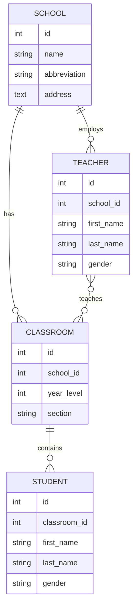

# Part 4 — School API (Django REST Framework)

## Run

> Django 5.0 รองรับ Python 3.10–3.12 (บน Python 3.14 test จะ error ใน template context ของ Django)

```bash
# จาก root ของ repo
py -3.12 -m venv .venv
.venv\Scripts\activate            # PowerShell: .venv\Scripts\Activate.ps1
pip install -r 4_rest_api/requirements.txt

cd 4_rest_api
python manage.py migrate
python manage.py createsuperuser   # API ต้อง login (IsAuthenticated + Basic/Session auth)
python manage.py runserver
python manage.py test apis         # 44 tests
```

## Data model



- ครู M:N ห้องเรียน, นักเรียน N:1 ห้องเรียน (ตามโจทย์)
- เพิ่ม `Teacher.school` เพื่อ filter/นับครูตามโรงเรียนได้ แม้ครูยังไม่ถูกผูกห้อง
- `gender`: `M`, `F`, `O`
- `(school, year_level, section)` unique — ห้อง 1/1 ซ้ำในโรงเรียนเดียวกันไม่ได้

## Endpoints

| Resource | List / Create | Retrieve / Update / Delete | List filters | Detail เพิ่ม |
|---|---|---|---|---|
| School | `/api/v1/schools/` | `/api/v1/schools/{id}/` | `name` (icontains) | `classroom_count`, `teacher_count`, `student_count` |
| Classroom | `/api/v1/classrooms/` | `/api/v1/classrooms/{id}/` | `school` | `school` (nested), `teachers`, `students` |
| Teacher | `/api/v1/teachers/` | `/api/v1/teachers/{id}/` | `school`, `classroom`, `firstname`, `lastname`, `gender` | `classrooms` (nested) |
| Student | `/api/v1/students/` | `/api/v1/students/{id}/` | `school`, `classroom`, `firstname`, `lastname`, `gender` | `classroom` (nested) |

- List ใช้ `PageNumberPagination` (`PAGE_SIZE=20`, `?page=2`)
- `firstname` / `lastname` เป็น `icontains`; `school`, `classroom`, `gender` เป็น exact match
- Status: `201` create, `200` read/update, `204` delete, `400` validation error, `401` ไม่ได้ login, `404` ไม่พบ

## Business rules

- ครูผูกได้เฉพาะห้องเรียนในโรงเรียนเดียวกับครู (`TeacherSerializer.validate`) — ตรวจทั้งตอนสร้าง, เปลี่ยนห้อง และเปลี่ยนโรงเรียน
- ห้ามย้ายห้องเรียนไปโรงเรียนอื่น ถ้ามีครูของโรงเรียนเดิมผูกอยู่ (`ClassroomSerializer.validate`)
- `year_level >= 1`

## Query performance

- School detail นับด้วย correlated subquery แยกกัน 3 ตัว (ไม่ JOIN classroom × teacher × student ซึ่งทำให้แถวระเบิด)
- Classroom: `select_related('school')` + `prefetch_related('teachers', 'students')` ใน detail
- Teacher: `select_related('school')` + `prefetch_related('classrooms')`
- Student: `select_related('classroom')`

## ตัวอย่าง

```http
POST /api/v1/teachers/
Content-Type: application/json

{"school": 1, "first_name": "Somchai", "last_name": "Jaidee", "gender": "M", "classrooms": [1, 2]}
```

```http
HTTP/1.1 201 Created
{"id": 1, "school": 1, "first_name": "Somchai", "last_name": "Jaidee", "gender": "M", "classrooms": [1, 2]}
```

```http
GET /api/v1/schools/1/

HTTP/1.1 200 OK
{"id": 1, "name": "Satit Demo", "abbreviation": "SD", "address": "Bangkok",
 "classroom_count": 2, "teacher_count": 1, "student_count": 2}
```

```http
POST /api/v1/teachers/   {"school": 1, ..., "classrooms": [3]}     # ห้อง 3 อยู่โรงเรียนอื่น

HTTP/1.1 400 Bad Request
{"classrooms": ["Classrooms [3] do not belong to the teacher's school."]}
```

## โครงสร้าง

```text
4_rest_api/
├── manage.py
├── requirements.txt
├── exam_app/            settings.py (pagination, filter backend), urls.py
└── apis/
    ├── models.py        School, Classroom, Teacher, Student, Gender
    ├── serializers.py   list/write serializer + detail serializer ของแต่ละ resource
    ├── filters.py       SchoolFilter, ClassroomFilter, TeacherFilter, StudentFilter
    ├── views/v1/        school.py, classroom.py, teacher.py, student.py (ModelViewSet)
    ├── urls.py          DefaultRouter -> /api/v1/...
    ├── admin.py
    ├── migrations/0001_initial.py
    └── tests/           base.py + test_school/classroom/teacher/student.py
```
