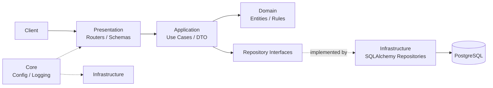
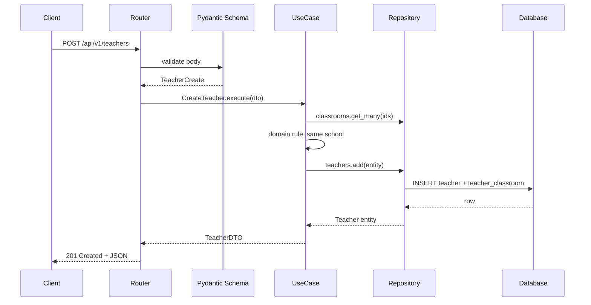

# School API — FastAPI DDD design

ออกแบบตามแนวทาง [fastapi-ddd-template](https://github.com/CodesForge/fastapi-ddd-template) โดยใช้ requirement เดียวกับ Part 4 (`4_rest_api/api_exam.md`)
งานที่ส่งตามข้อสอบคือเวอร์ชัน Django ใน `4_rest_api/` — เวอร์ชัน FastAPI ที่ implement ตามแบบนี้อยู่ใน `../fastapi-ddd-school/` (ดู README ในโฟลเดอร์นั้น)

## Layers

| Layer | หน้าที่ | สิ่งที่อยู่ข้างใน | ห้าม import |
|---|---|---|---|
| **Domain** | กฎทางธุรกิจล้วน ๆ | Entities (`School`, `Classroom`, `Teacher`, `Student`), Value objects (`Gender`, `YearLevel`), Repository interfaces (ABC), Domain errors, rule "ครูกับห้องต้องอยู่โรงเรียนเดียวกัน" | FastAPI, SQLAlchemy, Pydantic |
| **Application** | Orchestrate use case | Use cases (`CreateSchool`, `ListSchools`, `GetSchoolDetail`, `UpdateSchool`, `DeleteSchool`, ... ของทุก resource), DTO, Unit of Work interface | FastAPI, SQLAlchemy |
| **Infrastructure** | ติดต่อโลกภายนอก | SQLAlchemy models, Repository implementations, DB session, Alembic migrations | FastAPI |
| **Presentation** | HTTP | FastAPI routers, Pydantic request/response schemas, `Depends` DI, exception handlers (domain error → HTTP status) | SQLAlchemy |
| **Core** | Cross-cutting | Settings (`DATABASE_URL`), logging, base exceptions, security | — |

หลักการ:

- Dependency ชี้เข้าหา Domain เสมอ (Presentation → Application → Domain ← Infrastructure)
- Router ไม่เรียก ORM ตรง ๆ — เรียก use case ซึ่งทำงานผ่าน repository interface
- Infrastructure implement repository และถูก inject เข้า use case ผ่าน `Depends`
- Use case unit test ได้ด้วย fake/mock repository โดยไม่ต้องมี DB



## Folder structure

```text
fastapi-ddd-school/
├── src/
│   ├── core/
│   │   ├── config.py
│   │   ├── exceptions.py
│   │   └── logging.py
│   ├── domain/
│   │   ├── entities/            school.py, classroom.py, teacher.py, student.py
│   │   ├── value_objects/       gender.py, year_level.py
│   │   ├── repositories/        school_repository.py, classroom_repository.py, teacher_repository.py, student_repository.py
│   │   ├── services/            teacher_assignment.py   # same-school rule
│   │   └── exceptions.py        NotFound, DuplicateClassroom, CrossSchoolAssignment
│   ├── application/
│   │   ├── use_cases/           school/, classroom/, teacher/, student/
│   │   ├── dto/
│   │   └── unit_of_work.py
│   ├── infrastructure/
│   │   ├── db/                  base.py, session.py
│   │   ├── models/              SQLAlchemy ORM models + teacher_classroom association table
│   │   ├── repositories/        SqlAlchemy*Repository
│   │   └── migrations/          Alembic
│   └── presentation/
│       ├── api/v1/              schools.py, classrooms.py, teachers.py, students.py
│       ├── schemas/             Pydantic v2 request/response
│       ├── dependencies/        get_session, get_uow, use case providers
│       └── exception_handlers.py
├── tests/
│   ├── unit/                    domain + use cases (fake repositories)
│   └── integration/             API + real DB (httpx AsyncClient)
├── alembic.ini
├── pyproject.toml
├── docker-compose.yml
└── README.md
```

## Endpoints (เหมือนเวอร์ชัน Django)

| Resource | Method | Path | Query / Detail |
|---|---|---|---|
| School | GET, POST | `/api/v1/schools` | `name`, `page`, `page_size` |
| School | GET, PUT, PATCH, DELETE | `/api/v1/schools/{id}` | detail: `classroom_count`, `teacher_count`, `student_count` |
| Classroom | GET, POST | `/api/v1/classrooms` | `school` |
| Classroom | GET, PUT, PATCH, DELETE | `/api/v1/classrooms/{id}` | detail: `teachers`, `students` |
| Teacher | GET, POST | `/api/v1/teachers` | `school`, `classroom`, `firstname`, `lastname`, `gender` |
| Teacher | GET, PUT, PATCH, DELETE | `/api/v1/teachers/{id}` | detail: `classrooms` |
| Student | GET, POST | `/api/v1/students` | `school`, `classroom`, `firstname`, `lastname`, `gender` |
| Student | GET, PUT, PATCH, DELETE | `/api/v1/students/{id}` | detail: `classroom` |

Domain error → HTTP: `NotFound` → 404, `DuplicateClassroom` → 409, `CrossSchoolAssignment` → 422, Pydantic validation → 422 (ค่า default ของ FastAPI)

Error format เดียวกันทุก endpoint:

```json
{"detail": "Classrooms [3] do not belong to school 1", "code": "cross_school_assignment"}
```

## Request flow



## Query notes

- School detail: นับด้วย scalar subquery 3 ตัว (`select count(*) ... where school_id = :id`)
- Classroom detail: `selectinload(Classroom.teachers)`, `selectinload(Classroom.students)`
- Teacher list/detail: `selectinload(Teacher.classrooms)`
- Student detail: `joinedload(Student.classroom)`
- Teacher filter `classroom`: `JOIN teacher_classroom` + `DISTINCT`
