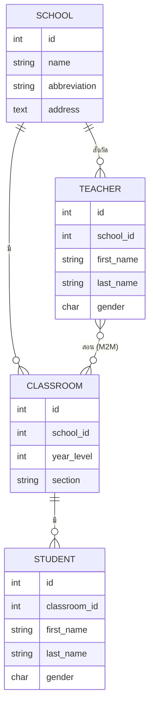
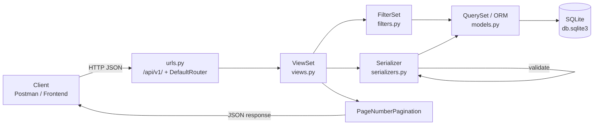
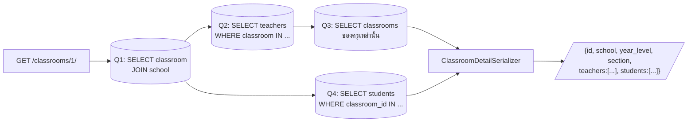
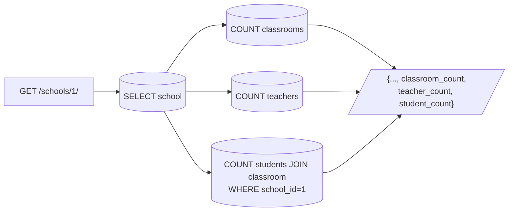
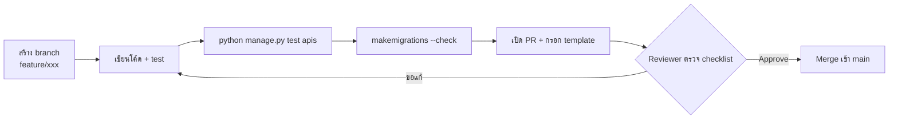
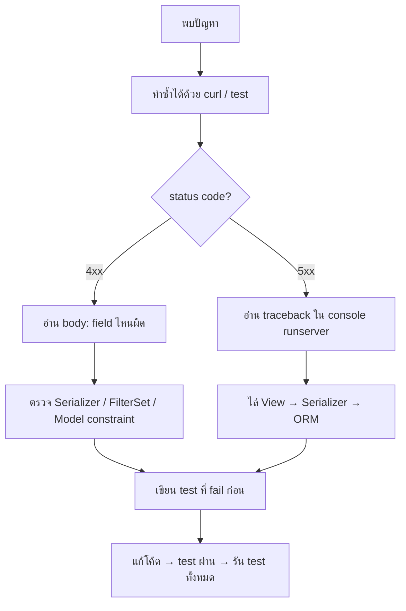

# คู่มือ exam_app — School REST API (Django + DRF)

> ระบบ REST API จัดการ **โรงเรียน · ห้องเรียน · ครู · นักเรียน** ด้วย Django 5.0 + Django REST Framework 3.15 + django-filter
> ตำแหน่งโปรเจกต์: `C:\github\backtend-test-2026\exam_app`

---

## สารบัญ

1. [บทนำ](#1-บทนำ)
2. [บทนิยาม](#2-บทนิยาม)
3. [วัตถุประสงค์](#3-วัตถุประสงค์)
4. [กลุ่มเป้าหมาย](#4-กลุ่มเป้าหมาย)
5. [ความรู้พื้นฐานที่ควรมี](#5-ความรู้พื้นฐานที่ควรมี)
6. [เนื้อหาโดยย่อ](#6-เนื้อหาโดยย่อ)
7. [โครงสร้างโฟลเดอร์](#7-โครงสร้างโฟลเดอร์--folder-structure)
8. [หลักการทำงาน (Concept)](#8-หลักการทำงาน-concept)
9. [โครงสร้างการทำงาน](#9-โครงสร้างการทำงาน)
10. [Workflow และ Dataflow](#10-workflow-และ-dataflow)
11. [การติดตั้ง](#11-การติดตั้ง)
12. [การทดสอบ + Check List Test](#12-การทดสอบ--คู่มือการทดสอบ)
13. [การใช้งาน (คู่มือการใช้งาน)](#13-การใช้งาน--คู่มือการใช้งาน)
14. [สรุป](#14-สรุป)
15. [Code Review / PR Check List](#15-ออกแบบ-code-review--code-pr)
16. [Root Cause Solution](#16-root-cause-solution)

---

## 1. บทนำ

`exam_app` คือ backend API สำหรับข้อมูลโรงเรียน เขียนแบบ "Django มาตรฐาน" คือใช้ `ModelViewSet` + `ModelSerializer` + `FilterSet`
ข้อดีคือโค้ดสั้น อ่านง่าย ทำ CRUD ครบ 4 resource ในโค้ดไม่กี่ร้อยบรรทัด
มีหน้า Browsable API ของ DRF และ Django Admin ให้ใช้ทันที

ความสัมพันธ์ของข้อมูล:



## 2. บทนิยาม

| คำ | ความหมาย |
|---|---|
| **Model** | คลาสใน `apis/models.py` ที่แทนตารางในฐานข้อมูล (ORM) |
| **Serializer** | แปลง Model ↔ JSON และตรวจความถูกต้อง (validation) |
| **ViewSet** | คลาสเดียวที่รวม list / create / retrieve / update / partial_update / destroy |
| **Router** | `DefaultRouter` สร้าง URL ให้ ViewSet อัตโนมัติ |
| **FilterSet** | django-filter แปลง query string (`?name=...`) เป็นเงื่อนไข ORM |
| **Pagination** | `PageNumberPagination` ตอบ `{count, next, previous, results}` ครั้งละ 20 รายการ |
| **year_level / section** | ชั้นปี / ทับ (เช่น ม.1/2 = year_level 1, section "2") |
| **Gender** | `M` = Male, `F` = Female, `O` = Other (`TextChoices`) |
| **CASCADE** | ลบแม่แล้วลบลูกตาม (ลบ school → ลบ classroom, teacher, student) |
| **N+1 query** | ยิง query 1 ครั้งต่อ 1 แถว แทนที่จะยิงครั้งเดียวทั้งชุด แก้ด้วย `select_related` / `prefetch_related` |

## 3. วัตถุประสงค์

1. ให้มี API CRUD ครบสำหรับ School, Classroom, Teacher, Student
2. ค้นหาและกรองข้อมูลด้วย query string ได้ (ชื่อ, โรงเรียน, ห้อง, เพศ)
3. ตรวจกฎธุรกิจ: **ห้องซ้ำ (ชั้นปี/ทับ) ในโรงเรียนเดียวกันไม่ได้** และ **ครูสอนได้เฉพาะห้องในโรงเรียนตัวเอง**
4. หน้า detail ให้ข้อมูลสรุป (จำนวนห้อง/ครู/นักเรียน) และข้อมูลที่เกี่ยวข้อง (ครู + นักเรียนในห้อง)
5. จำนวน query ต่อ request คงที่ ไม่ขึ้นกับจำนวนข้อมูล (ไม่มี N+1)

## 4. กลุ่มเป้าหมาย

- นักพัฒนา Backend Python/Django ที่จะดูแลหรือต่อยอดโปรเจกต์
- Frontend / Mobile developer ที่เรียก API
- QA / Tester ที่ทดสอบ API ด้วย Postman หรือ curl
- ผู้สอบ/ผู้ตรวจข้อสอบที่ต้องการเข้าใจโค้ดเร็ว ๆ

## 5. ความรู้พื้นฐานที่ควรมี

- Python 3.10+ และ virtual environment (`venv`)
- Django: models, migrations, `manage.py`
- DRF: Serializer, ViewSet, Router
- HTTP method (GET/POST/PUT/PATCH/DELETE) และ status code (200/201/204/400/404)
- SQL เบื้องต้น: FK, M2M, unique constraint

## 6. เนื้อหาโดยย่อ

| หัวข้อ | สาระสำคัญ | ประโยชน์ |
|---|---|---|
| ViewSet + Router | 1 คลาส = 6 endpoint | ลดโค้ดซ้ำ, URL เป็นมาตรฐาน |
| Serializer 2 ระดับ | ใช้ `XxxSerializer` ตอน list/create, ใช้ `XxxDetailSerializer` ตอน retrieve | list เบา, detail ได้ข้อมูลครบ |
| FilterSet | `icontains` สำหรับชื่อ, `iexact` สำหรับเพศ | ค้นหาไม่สนตัวพิมพ์ใหญ่เล็ก |
| `unique_together` | ห้องซ้ำ → 400 | ข้อมูลไม่ซ้ำตั้งแต่ระดับ DB |
| `TeacherSerializer.validate` | ห้องต้องอยู่โรงเรียนเดียวกับครู | กันข้อมูลผิดกฎธุรกิจ |
| `select_related` / `prefetch_related` | โหลดข้อมูลที่เกี่ยวข้องล่วงหน้า | query คงที่ 4 ครั้งใน classroom detail |

## 7. โครงสร้างโฟลเดอร์ | folder-structure

```text
exam_app/
├── manage.py                 # คำสั่ง Django (runserver, migrate, test)
├── requirements.txt          # Django 5.0.4, DRF 3.15.1, django-filter 24.2
├── .gitignore                # .venv, __pycache__, *.db, .env
├── exam_app/                 # project config
│   ├── settings.py           # INSTALLED_APPS, DATABASES (SQLite), REST_FRAMEWORK
│   ├── urls.py               # /admin/ และ /api/v1/ → apis.urls
│   └── wsgi.py
└── apis/                     # app หลัก
    ├── models.py             # Gender, School, Classroom, Teacher, Student
    ├── serializers.py        # Serializer + DetailSerializer + validate()
    ├── filters.py            # SchoolFilter, ClassroomFilter, TeacherFilter, StudentFilter
    ├── views.py              # 4 ModelViewSet
    ├── urls.py               # DefaultRouter register 4 resource
    ├── admin.py              # register model เข้า Django Admin
    ├── migrations/0001_initial.py
    └── tests/
        ├── test_school.py    # 3 tests
        └── test_resources.py # 10 tests
```

## 8. หลักการทำงาน (Concept)

1. **Convention over configuration** — ใช้ของที่ Django/DRF มีให้ ไม่สร้าง layer เพิ่ม
2. **Fat serializer, thin view** — กฎธุรกิจอยู่ใน `Serializer.validate()` ส่วน View แค่เลือก serializer และ queryset
3. **Constraint ที่ DB** — `unique_together("school","year_level","section")` และ `on_delete=CASCADE` ให้ DB ช่วยรักษาความถูกต้อง
4. **Serializer ตาม action** — `get_serializer_class()` คืน DetailSerializer เมื่อ `action == "retrieve"`
5. **Query ต้องคาดเดาได้** — queryset ของทุก ViewSet ระบุ `select_related`/`prefetch_related` และ `order_by("id")` (pagination ต้องมีลำดับที่แน่นอน)

## 9. โครงสร้างการทำงาน



| ชั้น | ไฟล์ | หน้าที่ |
|---|---|---|
| Routing | `exam_app/urls.py`, `apis/urls.py` | จับ URL → ViewSet + action |
| View | `apis/views.py` | queryset, filter backend, เลือก serializer |
| Filter | `apis/filters.py` | แปลง query string → `WHERE` |
| Serializer | `apis/serializers.py` | validate input, แปลงเป็น JSON |
| Model/ORM | `apis/models.py` | schema, constraint, ความสัมพันธ์ |
| DB | `db.sqlite3` | เก็บข้อมูล |

## 10. Workflow และ Dataflow

### 10.1 Workflow ภาพรวม (request หนึ่งครั้ง)

```mermaid
flowchart TD
    A([Client ส่ง HTTP Request]) --> B{URL ตรงกับ<br/>/api/v1/&lt;resource&gt;/ ?}
    B -- ไม่ตรง --> B1[404 Not Found]
    B -- ตรง --> C{HTTP Method}
    C -- GET list --> L1[DjangoFilterBackend<br/>กรองด้วย query string]
    L1 --> L2[Paginate 20 รายการ/หน้า]
    L2 --> L3[Serializer many=True]
    L3 --> OK200[200 OK<br/>count/next/previous/results]
    C -- GET id --> R1{มี id ใน DB?}
    R1 -- ไม่มี --> E404[404 Not Found]
    R1 -- มี --> R2[DetailSerializer]
    R2 --> OK200b[200 OK + ข้อมูลที่เกี่ยวข้อง]
    C -- POST/PUT/PATCH --> W1[Serializer.is_valid]
    W1 --> W2{ผ่าน field validation?<br/>ชนิด, choices, FK มีจริง}
    W2 -- ไม่ผ่าน --> E400[400 Bad Request]
    W2 -- ผ่าน --> W3{ผ่าน validate&#40;&#41;<br/>และ unique_together?}
    W3 -- ไม่ผ่าน --> E400
    W3 -- ผ่าน --> W4[serializer.save&#40;&#41;<br/>INSERT / UPDATE]
    W4 --> OK201[201 Created / 200 OK]
    C -- DELETE --> D1{มี id?}
    D1 -- ไม่มี --> E404
    D1 -- มี --> D2[DELETE + CASCADE]
    D2 --> OK204[204 No Content]
```



**คำอธิบายละเอียด**

1. **Routing** — `exam_app/urls.py` ส่งทุกอย่างที่ขึ้นต้น `api/v1/` ให้ `apis/urls.py` ซึ่ง `DefaultRouter` แมป `schools/` → `SchoolViewSet` ฯลฯ ถ้า path มี `{id}/` จะเป็น action แบบ detail
2. **เลือก action** — DRF แปลง method เป็น action: `GET /` = `list`, `POST /` = `create`, `GET /{id}/` = `retrieve`, `PUT` = `update`, `PATCH` = `partial_update`, `DELETE` = `destroy`
3. **List** — `DjangoFilterBackend` อ่าน `filterset_class` แล้วต่อ `WHERE` ลงใน queryset จากนั้น `PageNumberPagination` ตัด `LIMIT 20 OFFSET ...` และนับ `count`
4. **Retrieve** — `get_object()` หา id ถ้าไม่เจอ → 404 ถ้าเจอใช้ DetailSerializer ซึ่งแสดงข้อมูลซ้อน (nested)
5. **Write** — `is_valid()` ตรวจ 3 ชั้น: (ก) ชนิดข้อมูล/ความยาว/choices (ข) FK และ M2M id ต้องมีจริง (`PrimaryKeyRelatedField`) (ค) `UniqueTogetherValidator` + `validate()` ถ้าไม่ผ่านชั้นใดคืน 400 พร้อมชื่อ field
6. **Delete** — Django ทำ CASCADE ฝั่ง ORM: ลบ school → classrooms → students และ teachers + ตาราง M2M

### 10.2 Dataflow: สร้างครู (POST /api/v1/teachers/) — กฎ "ครูต้องสอนห้องในโรงเรียนตัวเอง"

```mermaid
flowchart TD
    IN[/"JSON body<br/>{school:1, first_name, last_name,<br/>gender:'M', classrooms:[1,3]}"/] --> S1[TeacherSerializer&#40;data=...&#41;]
    S1 --> S2{gender อยู่ใน M/F/O?}
    S2 -- ไม่ --> X1[400 gender: not a valid choice]
    S2 -- ใช่ --> S3{school id 1 มีจริง?<br/>classroom 1,3 มีจริง?}
    S3 -- ไม่ --> X2[400 Invalid pk]
    S3 -- ใช่ --> S4["validate(attrs)<br/>วนดู classroom.school_id == school.id"]
    S4 -- ห้อง 3 อยู่โรงเรียน 2 --> X3[400 classrooms: All classrooms<br/>must belong to the same school.]
    S4 -- ผ่าน --> S5[(INSERT apis_teacher)]
    S5 --> S6[(INSERT apis_teacher_classrooms<br/>teacher_id, classroom_id)]
    S6 --> OUT[/"201 {id, school, first_name,<br/>last_name, gender, classrooms:[1]}"/]
```



**กรณี PATCH เปลี่ยนเฉพาะ school**: `validate()` ใช้ `self.instance.classrooms.all()` เป็นห้องเดิม ถ้าห้องเดิมไม่อยู่โรงเรียนใหม่ → 400 (ทดสอบใน `test_teacher_school_change_validates_existing_classrooms`)

### 10.3 Dataflow: Classroom detail (GET /api/v1/classrooms/{id}/) — query คงที่ 4 ครั้ง



ได้จาก `select_related("school").prefetch_related("teachers__classrooms", "students")` ครู 10 คนหรือ 1000 คนก็ยัง 4 query (ทดสอบใน `test_classroom_detail_query_count_is_constant`)

### 10.4 Dataflow: School detail (GET /api/v1/schools/{id}/)



รวม 4 query ต่อ request (1 + 3 COUNT) ใช้ได้เพราะเป็น retrieve ทีละรายการ ห้ามนำ `SchoolDetailSerializer` ไปใช้กับ list (จะกลายเป็น N+1 แบบ 3N+1)

## 11. การติดตั้ง

**ต้องมี:** Python 3.10+ (ทดสอบแล้วกับ Python ใน `.venv`), Git

```powershell
cd C:\github\backtend-test-2026\exam_app

# 1) สร้างและเปิด virtual environment
python -m venv .venv
.\.venv\Scripts\Activate.ps1          # Git Bash: source .venv/Scripts/activate

# 2) ติดตั้ง dependency
pip install -r requirements.txt

# 3) สร้างตาราง
python manage.py migrate

# 4) (ไม่บังคับ) สร้าง user สำหรับ /admin/
python manage.py createsuperuser

# 5) รันเซิร์ฟเวอร์
python manage.py runserver            # http://127.0.0.1:8000/api/v1/
```

ตรวจว่าติดตั้งสำเร็จ: เปิด `http://127.0.0.1:8000/api/v1/` จะเห็น API Root ของ DRF ที่มีลิงก์ schools / classrooms / teachers / students

## 12. การทดสอบ | คู่มือการทดสอบ

### 12.1 รัน automated test

```powershell
python manage.py test apis            # ทั้งหมด
python manage.py test apis.tests.test_resources -v 2   # เฉพาะไฟล์ แสดงชื่อ test
```

ผลที่ได้จริง (รันเมื่อ 2026-11-23):

```text
Found 13 test(s).
Ran 13 tests in 0.137s
OK
```

Django สร้าง test database แยก (in-memory SQLite) ให้ทุกครั้ง ไม่กระทบ `db.sqlite3`

### 12.2 ชุด test ที่มี

| ไฟล์ | Test | ตรวจอะไร |
|---|---|---|
| test_school.py | `test_create_school` | POST → 201 |
| | `test_school_filter_by_name` | `?name=Demo` → count 1 |
| | `test_school_detail_counts` | classroom/teacher/student_count |
| test_resources.py | `test_duplicate_classroom_rejected` | ห้องซ้ำ → 400 |
| | `test_classroom_filter_by_school` | `?school=` |
| | `test_classroom_detail_lists_teachers_and_students` | nested teachers/students |
| | `test_classroom_detail_query_count_is_constant` | `assertNumQueries(4)` |
| | `test_teacher_cannot_join_other_school_classroom` | กฎข้ามโรงเรียน → 400 |
| | `test_teacher_invalid_gender_rejected` | gender=X → 400 |
| | `test_teacher_school_change_validates_existing_classrooms` | PATCH school → 400 |
| | `test_teacher_filters_and_detail` | 5 filter + detail |
| | `test_student_filters_and_detail` | 5 filter + detail |
| | `test_update_and_delete_school_cascades` | PATCH + DELETE cascade |

### 12.3 Check List Test

**Functional — CRUD**
- [ ] POST ทุก resource ได้ 201 และ body มี `id`
- [ ] GET list ได้ 200 รูปแบบ `{count, next, previous, results}`
- [ ] GET `/{id}/` ที่มีจริง → 200, ที่ไม่มี → 404
- [ ] PUT ส่งไม่ครบ field → 400; PATCH ส่งบาง field → 200
- [ ] DELETE → 204 และ GET ซ้ำ → 404

**Filter**
- [ ] `schools/?name=` contains, ไม่สนตัวพิมพ์
- [ ] `classrooms/?school=`
- [ ] `teachers/?school= &classroom= &firstname= &lastname= &gender=`
- [ ] `students/?school= &classroom= &firstname= &lastname= &gender=`
- [ ] `gender=m` (ตัวเล็ก) ใช้ได้
- [ ] filter ที่ไม่ตรงข้อมูล → count 0 ไม่ error

**Business rule / Validation**
- [ ] ห้อง year_level+section ซ้ำในโรงเรียนเดียวกัน → 400
- [ ] ห้องเดียวกันต่างโรงเรียน → 201 (ไม่ถือว่าซ้ำ)
- [ ] ครูผูกห้องของโรงเรียนอื่น → 400 `classrooms`
- [ ] PATCH ย้ายครูไปโรงเรียนอื่นขณะมีห้องเดิม → 400
- [ ] gender นอก M/F/O → 400
- [ ] FK id ที่ไม่มีอยู่ → 400 `Invalid pk`
- [ ] year_level ติดลบ → 400 (PositiveSmallIntegerField)

**Detail / Performance**
- [ ] School detail มี count 3 ค่าถูกต้อง
- [ ] Classroom detail มี teachers + students
- [ ] Teacher detail มี classrooms แบบ object
- [ ] Student detail มี classroom แบบ object
- [ ] Classroom detail ใช้ 4 query เสมอ

**Cascade**
- [ ] ลบ school → classroom, teacher, student ของโรงเรียนนั้นหายหมด
- [ ] ลบ classroom → student ในห้องหาย, ครูยังอยู่แต่หลุดจากห้อง

**Pagination**
- [ ] ข้อมูล > 20 แถว มี `next`; `?page=2` ใช้ได้; page เกิน → 404

## 13. การใช้งาน | คู่มือการใช้งาน

### 13.1 Endpoint ทั้งหมด

Base URL: `http://127.0.0.1:8000/api/v1/` (ต้องมี `/` ท้าย URL)

| Resource | List/Create | Retrieve/Update/Delete | Filter | Detail เพิ่ม |
|---|---|---|---|---|
| School | `schools/` | `schools/{id}/` | `name` | `classroom_count`, `teacher_count`, `student_count` |
| Classroom | `classrooms/` | `classrooms/{id}/` | `school` | `teachers[]`, `students[]` |
| Teacher | `teachers/` | `teachers/{id}/` | `school`, `classroom`, `firstname`, `lastname`, `gender` | `classrooms[]` (object) |
| Student | `students/` | `students/{id}/` | `school`, `classroom`, `firstname`, `lastname`, `gender` | `classroom` (object) |

> ข้อสังเกต: body ใช้ชื่อ field `school`, `classroom`, `classrooms` (id) ไม่ใช่ `school_id`

### 13.2 ตัวอย่างโค้ดที่รันได้จริง (curl — Git Bash)

```bash
BASE=http://127.0.0.1:8000/api/v1

# สร้างโรงเรียน
curl -s -X POST $BASE/schools/ -H "Content-Type: application/json" \
  -d '{"name":"Satit Demo","abbreviation":"SD","address":"Bangkok"}'
# => {"id":1,"name":"Satit Demo","abbreviation":"SD","address":"Bangkok"}

# สร้างห้อง ม.1/1
curl -s -X POST $BASE/classrooms/ -H "Content-Type: application/json" \
  -d '{"school":1,"year_level":1,"section":"1"}'

# สร้างครูและผูกห้อง
curl -s -X POST $BASE/teachers/ -H "Content-Type: application/json" \
  -d '{"school":1,"first_name":"Somchai","last_name":"Jaidee","gender":"M","classrooms":[1]}'

# สร้างนักเรียน
curl -s -X POST $BASE/students/ -H "Content-Type: application/json" \
  -d '{"classroom":1,"first_name":"Somsri","last_name":"Dee","gender":"F"}'

# ค้นหาครูชื่อมี "som" เพศชาย
curl -s "$BASE/teachers/?firstname=som&gender=m"

# ดูรายละเอียดโรงเรียน
curl -s $BASE/schools/1/
# => {"id":1,...,"classroom_count":1,"teacher_count":1,"student_count":1}

# แก้บางส่วน / ลบ
curl -s -X PATCH $BASE/schools/1/ -H "Content-Type: application/json" -d '{"name":"Satit 2"}'
curl -s -X DELETE $BASE/schools/1/ -o /dev/null -w "%{http_code}\n"   # 204
```

### 13.3 ตัวอย่าง Python client

```python
import requests

BASE = "http://127.0.0.1:8000/api/v1"
school = requests.post(f"{BASE}/schools/", json={"name": "A", "abbreviation": "A", "address": "x"}).json()
room = requests.post(f"{BASE}/classrooms/", json={"school": school["id"], "year_level": 1, "section": "1"}).json()
r = requests.post(f"{BASE}/teachers/", json={
    "school": school["id"], "first_name": "T", "last_name": "L", "gender": "M", "classrooms": [room["id"]],
})
print(r.status_code, r.json())   # 201 {...}
```

### 13.4 ตัวอย่าง Error response

```json
// 400 ห้องซ้ำ
{"non_field_errors": ["The fields school, year_level, section must make a unique set."]}

// 400 ผูกครูกับห้องต่างโรงเรียน
{"classrooms": ["All classrooms must belong to the same school."]}

// 400 gender ผิด
{"gender": ["\"X\" is not a valid choice."]}

// 404
{"detail": "No School matches the given query."}
```

### 13.5 ทดสอบด้วย Postman CLI

สร้าง Collection ใน Postman ด้วย request ตามข้อ 13.2 ตั้ง `{{base}} = http://127.0.0.1:8000/api/v1` แล้วรัน:

```powershell
postman collection run <collection-id-หรือ-ไฟล์.json> --env-var "base=http://127.0.0.1:8000/api/v1"
```

### 13.6 Django Admin

`http://127.0.0.1:8000/admin/` (login ด้วย superuser) จัดการข้อมูลทั้ง 4 ตารางผ่านหน้าเว็บได้

## 14. สรุป

### ประโยชน์ที่ได้รับ
- ได้ REST API ครบ CRUD + filter + pagination ด้วยโค้ดน้อย
- มี Browsable API และ Admin ไว้ดู/แก้ข้อมูลได้ทันที
- กฎธุรกิจสำคัญมี test ครอบ (13 tests)
- query คงที่ ไม่โตตามข้อมูล

### ข้อดี
- เรียนรู้ง่าย เป็นแบบ Django มาตรฐาน คนใหม่อ่านเข้าใจเร็ว
- Migration, Admin, test runner มีในตัว
- ต่อ resource ใหม่ได้เร็ว (Model → Serializer → FilterSet → ViewSet → register)

### ข้อเสีย
- กฎธุรกิจผูกกับ Serializer (ถ้าแก้ข้อมูลผ่าน Admin หรือ shell จะ **ไม่ผ่าน** `TeacherSerializer.validate`)
- Test ต้องใช้ DB เสมอ (ไม่มี unit test ที่แยกจาก DB)
- Error format เป็นแบบ DRF default (ไม่มี `code` แยกประเภท)
- Sync I/O (WSGI) รองรับ concurrent ได้น้อยกว่า async

### ข้อควรระวัง
- `settings.py` มี `SECRET_KEY` แบบ hard-code และ `DEBUG = True` → ใช้ได้เฉพาะ dev
- ไม่มี authentication/permission (DRF default = `AllowAny`) ใครก็แก้/ลบได้
- `ALLOWED_HOSTS = []` ใช้ได้เฉพาะ localhost เมื่อ DEBUG=True
- URL ต้องมี `/` ท้าย (`APPEND_SLASH`) ถ้า POST โดยไม่มี `/` จะได้ error
- ลบ school แล้วข้อมูลลูกหายทั้งหมด (CASCADE) ไม่มี soft delete

### ข้อห้าม
- ห้ามใช้ `SchoolDetailSerializer` ใน action `list` (เกิด 3N+1 query)
- ห้ามลบ `order_by("id")` ออกจาก queryset (pagination จะให้ผลไม่แน่นอน + DRF เตือน `UnorderedObjectListWarning`)
- ห้าม deploy ด้วย `DEBUG=True` หรือ commit `SECRET_KEY` จริง
- ห้ามแก้ไฟล์ migration ที่ถูก apply แล้ว ให้สร้าง migration ใหม่

## 15. ออกแบบ Code Review / Code PR

### 15.1 ขั้นตอน PR



### 15.2 PR Template

```markdown
## สิ่งที่เปลี่ยน
-
## เหตุผล / Issue
-
## วิธีทดสอบ
- [ ] python manage.py test apis ผ่าน
- [ ] ทดสอบ manual ด้วย curl/Postman: ...
## Migration
- [ ] ไม่มี / มี (ระบุไฟล์)
```

### 15.3 Code Review Check List

**Model / Migration**
- [ ] เปลี่ยน model แล้วมีไฟล์ migration (`python manage.py makemigrations --check --dry-run` ไม่ฟ้อง)
- [ ] FK เลือก `on_delete` ถูกต้อง (CASCADE / PROTECT / SET_NULL)
- [ ] constraint ระดับ DB สำหรับกฎ unique
- [ ] มี `related_name` ชัดเจน

**Serializer**
- [ ] `fields` ระบุชัด ไม่ใช้ `"__all__"`
- [ ] กฎธุรกิจอยู่ใน `validate()` และรองรับทั้ง create และ partial update (`self.instance`)
- [ ] field ที่ nested เป็น `read_only=True`
- [ ] ไม่มี query ใน `SerializerMethodField` ที่ถูกเรียกใน list

**View / Query**
- [ ] queryset มี `select_related`/`prefetch_related` ครบตามที่ serializer ใช้
- [ ] มี `order_by`
- [ ] filter ใหม่อยู่ใน `FilterSet` ไม่เขียนใน `get_queryset` แบบ manual
- [ ] มี `assertNumQueries` สำหรับ endpoint ที่มี nested

**Test**
- [ ] มี test ทั้ง happy path และ error path (400/404)
- [ ] test ใช้ข้อมูลที่สร้างเองใน `setUp` ไม่พึ่งข้อมูลใน DB จริง

**Security / Config**
- [ ] ไม่มี secret ใน code
- [ ] endpoint ใหม่พิจารณา permission

## 16. Root Cause Solution

| # | อาการ | สาเหตุ (Root Cause) | วิธีแก้ |
|---|---|---|---|
| 1 | `no such table: apis_school` | ยังไม่ได้ migrate | `python manage.py migrate` |
| 2 | `ModuleNotFoundError: No module named 'django'` / `rest_framework` | ไม่ได้ activate `.venv` หรือไม่ได้ติดตั้ง | `.\.venv\Scripts\Activate.ps1` แล้ว `pip install -r requirements.txt` |
| 3 | POST แล้วได้ `RuntimeError ... APPEND_SLASH` | URL ไม่มี `/` ท้าย | ใช้ `/api/v1/schools/` |
| 4 | 400 `must make a unique set` | ห้อง (school, year_level, section) ซ้ำ | เปลี่ยน section หรือใช้ห้องเดิม |
| 5 | 400 `All classrooms must belong to the same school.` | ส่ง classroom id ของโรงเรียนอื่น หรือ PATCH school ขณะครูยังมีห้องเดิม | PATCH `school` พร้อม `classrooms` ใหม่ในครั้งเดียว |
| 6 | 400 `Invalid pk "99" - object does not exist.` | อ้าง FK ที่ไม่มี | สร้างข้อมูลแม่ก่อน หรือแก้ id |
| 7 | 400 `"X" is not a valid choice.` | gender ไม่ใช่ M/F/O | ส่ง `M`, `F`, `O` (ตัวใหญ่ตอนสร้าง; filter ใช้ตัวเล็กได้) |
| 8 | Response ช้าเมื่อข้อมูลเยอะ | N+1 query (ลืม prefetch หรือใช้ DetailSerializer ใน list) | เพิ่ม `select_related`/`prefetch_related`, ตรวจด้วย `assertNumQueries` หรือ django-debug-toolbar |
| 9 | `UnorderedObjectListWarning` | queryset ไม่มี `order_by` | เพิ่ม `.order_by("id")` |
| 10 | `DisallowedHost` ตอน deploy | `ALLOWED_HOSTS` ว่าง + `DEBUG=False` | ใส่ host จริงใน `ALLOWED_HOSTS` |
| 11 | `database is locked` | SQLite รองรับเขียนพร้อมกันน้อย | ใช้ PostgreSQL สำหรับ production |
| 12 | ข้อมูลผิดกฎแต่บันทึกได้ผ่าน Admin | กฎอยู่ใน Serializer ไม่อยู่ใน Model | ย้ายกฎไป `Model.clean()` หรือ service layer แล้วเรียกจากทั้ง Admin และ Serializer |

**วิธีหาสาเหตุแบบเป็นขั้นตอน**


